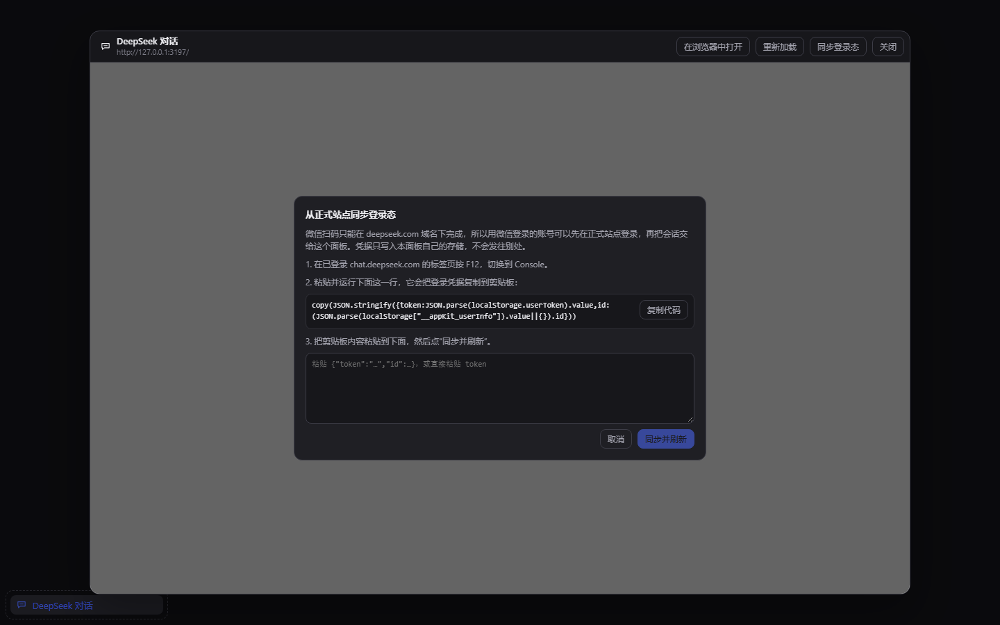

# DeepSeek 对话面板 / DeepSeek chat panel

在 Harness 里直接和 [chat.deepseek.com](https://chat.deepseek.com/) 聊天，并保留登录状态。

Open **chat.deepseek.com inside Harness** and keep the DeepSeek login across page reloads and
Harness restarts.



## 安装 / Install

在 Harness 的插件市场里搜索 `dsh-deepseek-chat-panel` 安装并启用（装完重启 `dsh web`）。
也可以走命令行：

```bash
# 从 npm 安装
dsh plugin --profile web add dsh-deepseek-chat-panel

# 或直接从源码目录安装（开发用；插件以 link 方式装入，改完 Host 端代码重启 Harness 生效）
dsh plugin --profile web add D:\MyCodes\test\deepseek\dsh-deepseek-chat-panel
```

`dsh plugin add` 只是把包装进 profile，**还需要在 Harness 的插件列表里启用它**（启用即写入该
bundle 的 `cordis.patch.yml` 行），然后重启 Harness。

## 为什么需要代理 / Why a proxy

`chat.deepseek.com` 返回 `content-security-policy: frame-ancestors 'none'`，浏览器不允许把它直接
嵌进 iframe；它的会话 Cookie 还是 `HttpOnly; Secure; SameSite=Strict`，网页里的脚本读不到、换了端口
或重启就丢。

因此本插件的 **Host 端**在本机回环地址上跑一个反向代理：

- 把上游文档的 `frame-ancestors` / `X-Frame-Options` 等头去掉，页面才能被 iframe 加载；
- 把页面的 `Set-Cookie` 收进 Host 侧的 Cookie 罐（`~/.dsh/deepseek-chat/cookies.json`），
  请求上游时再注入。登录状态因此存在磁盘上，**重启 Harness 或换浏览器都不会丢**；
- 把入口 bundle（`main.*.js`）改写后同源提供：强制生产环境（否则回环 IPv4 会被判成 `dev`）、
  把 rspack 的 CDN public path 指向代理（懒加载 chunk 才能同源加载）、TTS 的 WebSocket 按页面
  协议选择 `ws`/`wss`；
- 样式表里的字体 / 图片也改走代理，避免 CDN 的 CORS 规则（`https://*.deepseek.com`）在回环源上失效。

**Page 端**只做两件事：侧栏底部一个按钮，加上一个全屏浮层 iframe（`shell.overlay`），
iframe 指向代理地址；代理端口通过 Harness 的 `/plugins/deepseek-chat/status` 路由告知页面，
3097 被占用时自动改用空闲端口。

## 用法 / Usage

1. 刷新 Harness 页面。
2. 点击左下角（设置按钮旁）的聊天气泡按钮 → 面板打开，加载 chat.deepseek.com。
3. 在面板里登录一次（手机号 / 邮箱验证码、密码都可用）；之后登录状态由 Host 保存。
   只绑定了微信的账号请用下面的「登录态同步」。
4. 面板标题栏：**在浏览器中打开**（同一代理地址，可完成需要在顶层窗口进行的登录）、
   **重新加载**、**同步登录态**、**关闭**。`Esc` 也能关闭；关闭后 iframe 仍在后台保留，
   重新打开对话不会中断。

## 微信扫码 / 登录态同步 · WeChat QR and login import

面板里的微信二维码**不可能**正常显示：微信的 `WxLogin` 组件会把 `redirect_uri`（由页面
`location.origin` 拼出）拿去和 appid `wx932d4fdaf46d5611` 的授权域名比对，只有 `deepseek.com`
域名下的页面才返回二维码；回环地址只会拿到微信自己的错误页（`redirect_uri 参数`）。
扫码成功后浏览器还必须落在 `chat.deepseek.com` 上换登录态，这一步也无法在面板里完成。

所以用微信登录的账号这样用：

1. 在普通浏览器里正常登录 https://chat.deepseek.com/（微信扫码可以正常用）。
2. 在该标签页按 `F12` → Console，运行面板「同步登录态」里给出的那一行，把凭据复制下来。
3. 回到 Harness → 打开面板 → **同步登录态** → 粘贴 → **同步并刷新**。

凭据写入的是面板自己这一侧的 `localStorage`（`userToken`、`__appKit_userInfo`，正是网页登录
流程自己写的那两个键），不经过任何服务器，也不改动 Cookie 罐。同步后登录态同样保留在磁盘上，
直到 token 过期。改完 Host 端代码后需要重启 Harness（`dsh web`）；页面端刷新即可。

提交走的是 Harness 同源的 `POST /plugins/deepseek-chat/sync`（Host 端入队，再由
`src/proxy.js` 在下次文档加载时注入），所以不涉及跨域；代理侧的 `POST /__ds/sync` 保留给
`scripts/dev-proxy.mjs` 这类脱离 Harness 的场景。只接受本机回环来源、只接受一次性凭据文本，
不提供任何读取接口。

## 配置 / Configuration

Host 端的可调项用环境变量（改完重启 Harness 生效）：

| 变量 | 默认值 | 说明 |
| --- | --- | --- |
| `DSH_DEEPSEEK_CHAT_PORT` | `3097` | 代理首选端口；占用时自动退到空闲端口 |
| `DSH_DEEPSEEK_CHAT_STATE` | `<DSH_HOME>/deepseek-chat` | Cookie 罐目录（`cookies.json`、`pending-sync.json`） |
| `DSH_DEEPSEEK_CHAT_DEBUG` | 未设置 | 设为 `1` 时把上游请求（含是否带 `Authorization`）打到 Host 日志 |

## 已知限制 / Limits

- 代理只绑定 `127.0.0.1`，并拒绝带外站 `Origin` 的请求；但它毕竟持有一份登录态，同一台机器上
  的其他进程仍可访问该端口。
- 第三方网页里 DeepSeek 自己的深浅色主题独立于 Harness 主题（第三方站点无法继承 Harness 的
  `--dsw-alias-*` 令牌），这是把外部站点嵌入面板的固有取舍。
- Google/Apple 等第三方 OAuth 通常在弹窗里完成；若某流程要求顶层跳转导致被拒绝，请用标题栏的
  **在浏览器中打开** 完成登录——两者共用同一个 Cookie 罐，所以登录结果会同步回来。
- 微信扫码在面板里不可用（微信侧按授权域名校验 `redirect_uri`，见上文），请用验证码登录或
  「同步登录态」；Apple 登录同理，需在 `deepseek.com` 域名下完成。
- 登录态同步（`/plugins/deepseek-chat/sync` 或 `/__ds/sync`）只接受本机回环来源提交的一次性凭据文本，
  不提供读取接口；凭据以明文存放在面板 origin 的 `localStorage` 和 `pending-sync.json` 里，直到被应用或过期。
- 上游是随时会变的第三方前端：入口 bundle 的改写是字符串匹配，升级后若某个 pattern 失配，
  Host 日志会打印 `entry bundle patterns missing: …`，页面可能白屏，需要更新 `src/transform.js`。
